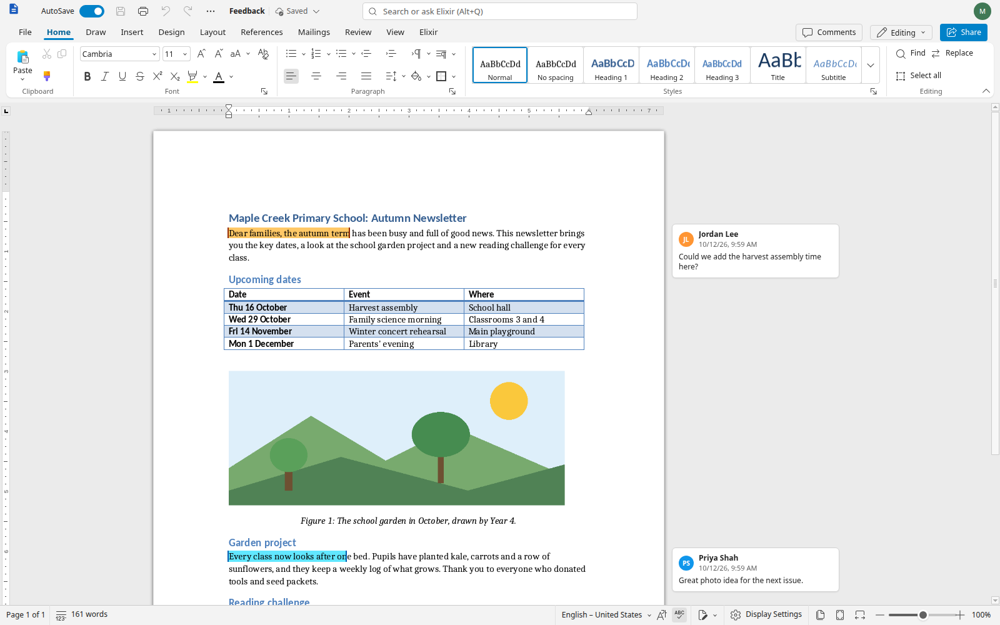
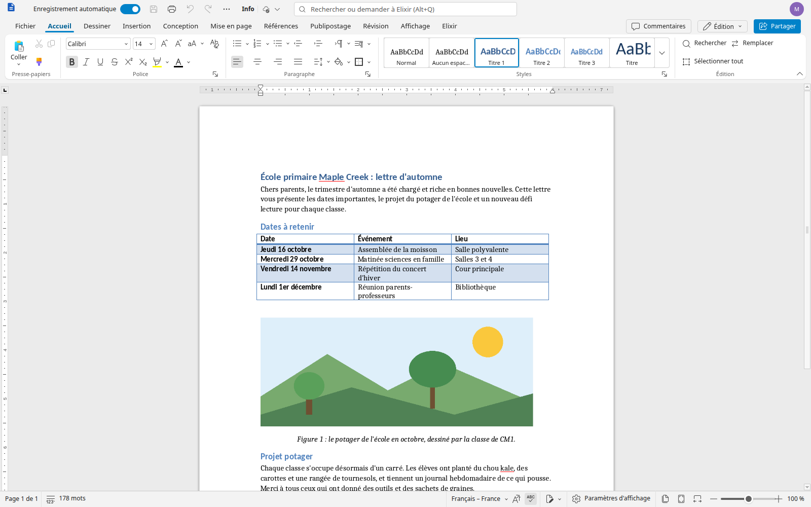
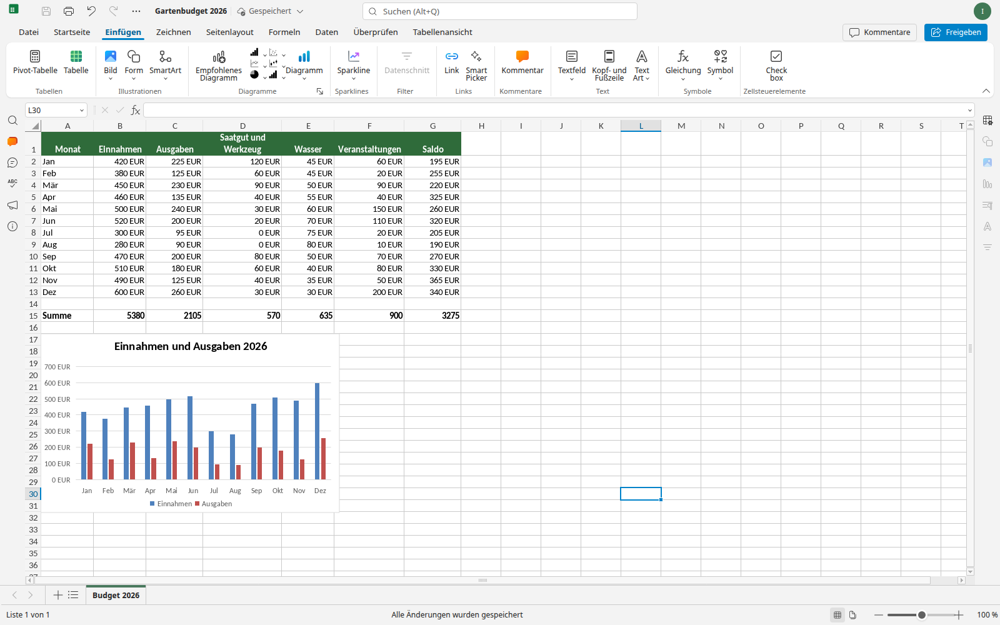

# MisaOffice

**An open-source office suite for small offices and teams.**

MisaOffice is a rebrand and continuation of the ElixirOffice source tree, itself based on Euro-Office and ONLYOFFICE. It edits Word, Excel and PowerPoint documents and their OpenDocument equivalents, runs locally or on a self-hosted server, and retains the upstream projects' required copyright, licence and attribution notices.

> Status: **beta / in development**. This checkout has not published MisaOffice installers or server images. The historical ElixirOffice releases listed below are not MisaOffice builds; do not treat them as MisaOffice downloads.

## MisaOffice downloads

MisaOffice release packages are not available yet. Build and qualify this source tree using [the desktop guide](docs/desktop.md) or [the development guide](docs/dev.md). Release history and links below identify the source project's previous releases only.

## Source-project release history (not MisaOffice releases)

| Version | Date | What it is |
|---|---|---|
| [Desktop 0.3.1](https://github.com/leag1234/elixiroffice/releases/tag/v0.3.1) | 2026-10-22 | Separate document windows, optional tabs/Home, Office-style start and File commands, remembered placement, equation/menu fixes and opening diagnostics |
| [Desktop 0.3.0](https://github.com/leag1234/elixiroffice/releases/tag/v0.3.0) | 2026-10-21 | Add document tabs and detach/move; improve dialogs, fonts, ODS chart caches and Linux dependencies |
| [Desktop 0.2.4 beta](https://github.com/leag1234/elixiroffice/releases/tag/v0.2.4) | 2026-10-20 | Improve Windows saving and diagnostics; fix toolbar contrast, page shadows and print feedback |
| [Desktop 0.2.3 beta](https://github.com/leag1234/elixiroffice/releases/tag/v0.2.3) | 2026-10-19 | Fix Debian sandbox permissions on Ubuntu 26.04; clarify platform download links |
| [Desktop 0.2.2 beta](https://github.com/leag1234/elixiroffice/releases/tag/v0.2.2) | 2026-10-19 | Windows save and font fixes, native printing, keyboard and accessibility improvements, RTL Home layouts and converter hardening |
| [Desktop 0.2.1 beta](https://github.com/leag1234/elixiroffice/releases/tag/v0.2.1) | 2026-10-16 | Fixes: opening files after a settings or network-share error, Office-identical shortcuts, Word-like close dialog, Save As redesign, export progress, PDF page rotation |
| [Desktop 0.2.0 beta](https://github.com/leag1234/elixiroffice/releases/tag/v0.2.0) | 2026-10-15 | PDF open, annotate, fill and save; password-protected files; rename and Save a copy folder; computer fonts switch |
| [Server 0.1.1 beta 1.1](https://github.com/leag1234/elixiroffice/releases/tag/v0.1.1) | 2026-10-15 | Rename and Save a copy fixes for the server |
| [Desktop 0.1.0 beta 2](https://github.com/leag1234/elixiroffice/releases/tag/v0.1.0-beta.2) | 2026-10-13 | First desktop apps for Windows, macOS and Linux |
| [Server 0.1.0 beta 1](https://github.com/leag1234/elixiroffice/releases/tag/v0.1.0-beta.1) | 2026-10-12 | First public version: self-hosted server |

Details of every change: [CHANGELOG.md](CHANGELOG.md).

## Why this project

Small offices need tools that are familiar, work with documents received from clients, and do not require a cloud subscription. MisaOffice continues that goal by building on the mature editor engine, compatibility work and user-interface improvements already present in its source project.

## What makes it different

- **It behaves like Microsoft Office.** The same ribbon tabs and groups, KeyTips (Alt), mini toolbar, quick access toolbar, contextual tabs, and the same keyboard shortcuts: 228 Word shortcuts work on Windows and 171 on macOS, including Repeat (F4 / Ctrl+Y), Outline, Read and Draft views, fields, block selection, mail merge, Flash Fill, Quick Analysis, sections and the Slide Sorter. Muscle memory keeps working.
- **Your documents look right.** Layout fidelity to Word is measured on a document corpus, release after release. Free metric-compatible fonts keep line and page breaks without Microsoft fonts, and in Chrome or Edge one click lets the editor use the fonts installed on your computer. School fonts (Marelle and Seyes-ruled cursive substitutes) are included.
- **Private by design.** No telemetry, nothing sent to the publisher. In the desktop app and in the optional "convert locally" mode, documents never leave your computer: they are converted and edited entirely on your machine.
- **AI only if you want it.** The suite is complete without AI. If you configure a model (any OpenAI-compatible service, including Ollama on your own computer), it can work on the structure of your document (styles, lists, tables, table of contents, page setup), with every change shown as a tracked change and undone in one step.
- **Your own cloud: Murena Workspace and Nextcloud.** Connect your Murena Workspace or Nextcloud from the start page (secure Login Flow, revocable app password, nothing stored in the browser): browse, open, save back with conflict protection, recent files, new documents and uploads. Your real name appears on comments, tracked changes and co-editing. An app to edit directly from Nextcloud Files is coming in an upcoming beta, and the connection is coming to the desktop app later.
- **International.** Every feature works in many languages: 45 interface languages, 49 spelling dictionaries (39 languages), a thesaurus in 17 languages.

### More things you will like

- **PDF made on your computer**: Download as PDF and Print create the PDF locally, with the fonts you see on screen.
- **Your computer's fonts**: in Chrome or Edge, one click and the editor uses the fonts installed on your computer, nothing uploaded.
- **Comments in the margin**, like Word: balloons next to the text, reply and resolve in place.
- **Mail merge** from a CSV or Excel file to one document, one PDF or one PDF per recipient.
- **Outline, Read Mode, Draft view, split window, block selection, fields** and the Selection and Reveal Formatting panes.
- **AutoCorrect while typing** and **spelling suggestions on right-click**, in many languages; an offline **thesaurus** (Shift+F7).
- **Pictures that stay where you put them**, and tables that behave (grouped shapes stay in their cell, copied cells keep rotated text and colours).
- **Excel and PowerPoint habits**: Flash Fill (Ctrl+E), Quick Analysis (Ctrl+Q), Auto Fill Options, chart galleries by type, F4 for Repeat and absolute references; Slide Sorter, sections, Selection pane and Presenter View with the next slide.
- **Office keys the browser normally keeps** (Ctrl+W, Ctrl+N, Ctrl+Tab...): install MisaOffice as an app or use full screen, or use the documented alternatives.
- **AI with your own model**: ask from the search box, a right-click or "/" in the text; any OpenAI-compatible service, including a model running on your own computer.

The feature list above describes capabilities in the inherited source tree; MisaOffice packages still need to be built and qualified.

## Fast, thanks to an optimised WebAssembly converter

The document converter (the C++ engine that reads and writes .docx, .xlsx, .pptx, .odt, .ods and .odp) is compiled to **WebAssembly** and runs inside the browser or the desktop app:

- built with native WebAssembly exceptions and a reworked static initialisation, which cut the module from 106 MB to 53 MB and made large documents open about ten times faster than a plain build;
- a 97-page Word document is converted in about **0.4 s**; saving it takes **0.08 s**;
- the module downloads once, **3.1 MB compressed** (Brotli), then stays in the browser cache;
- PDF export uses the same native PDF writer as the server, in the browser: same quality and same file size as a server-made PDF, with no upload;
- only the fonts a document uses are loaded.

On a modest laptop (Intel i5-8265U), a 97-page document becomes editable in about 3.5 s, layout continues in the background, and typing latency stays around 30 ms. Measurements and methods: [docs/wasm.md](docs/wasm.md), [docs/perf.md](docs/perf.md), [docs/desktop-options.md](docs/desktop-options.md).

## Screenshots

| Word | Excel | PowerPoint |
|---|---|---|
|  |  |  |

In your language (here French, German and Japanese):

| Français | Deutsch | 日本語 |
|---|---|---|
|  |  |  |

## Two ways to use it

| | Server version | Desktop app |
|---|---|---|
| For | organisations, Murena Workspace / Nextcloud, shared documents | individuals, offline use |
| How | your own server (Docker), in the browser | Windows, macOS (Apple Silicon), Linux |
| Documents | real-time co-editing, cloud storage; optional "convert locally" mode | 100 % local, no document server |
| Source baseline | 0.1.1 beta 1.1 (upstream) | 0.3.1 (upstream) |
| Install | [docs/install-server.md](docs/install-server.md) | [docs/desktop.md](docs/desktop.md) |

## Build and try from source

MisaOffice installers and server images have not been released. To work from this checkout, follow the [desktop build guide](docs/desktop.md), [server installation guide](docs/install-server.md) and [development guide](docs/dev.md). Historical ElixirOffice release downloads and images are built and published by the upstream project and are not MisaOffice distributions.

## Features

The feature summary above describes the inherited Word, Excel and PowerPoint editing capabilities. A comparison with LibreOffice and ONLYOFFICE is in [docs/differences.md](docs/differences.md).

## Building from source

- Server image and development environment: [docs/install-server.md](docs/install-server.md), [docs/dev.md](docs/dev.md)
- WebAssembly converter: [docs/wasm.md](docs/wasm.md) (`tools/wasm/build.sh`)
- Desktop app: [docs/desktop.md](docs/desktop.md)

## Licence and attribution

MisaOffice source is released under the **GNU Affero General Public License v3.0** ([LICENSE](LICENSE)), and preserves the upstream projects' copyright and attribution notices.

It is built on **[Euro-Office](https://github.com/Euro-Office)**, itself derived from **[ONLYOFFICE](https://www.onlyoffice.com/)** Docs by Ascensio System SIA. Their copyright notices, licence files and attributions are kept in the source code; see [NOTICE](NOTICE). Bundled fonts, dictionaries, thesauri and icons (Microsoft Fluent UI System Icons, MIT) keep their own free licences: [branding/fonts/LICENSES.md](branding/fonts/LICENSES.md), the dictionaries and thesaurus licence files, and [NOTICE](NOTICE).

MisaOffice is not affiliated with or endorsed by Microsoft, Ascensio System SIA, Euro-Office or the ElixirOffice project. Microsoft, Word, Excel and PowerPoint are trademarks of Microsoft Corporation.

## Contributing, bug reports and feedback

Feedback from real users, especially anyone who switched from Microsoft Office, is the most valuable contribution.

- **Report a bug**: open an [issue](../../issues) with the version (Help > About, or the release name), your system and browser, what you did, what you expected and what happened. A screenshot helps. If a document triggers the problem, attach a small example **only if it contains nothing private**; otherwise describe it, or recreate the problem in a new document.
- **"It does not work like in Word / Excel / PowerPoint"**: these reports are welcome as issues too. Tell us what Microsoft Office does (the menu, the shortcut, the result) and what MisaOffice does instead.
- **Ideas and questions**: use [Discussions](../../discussions).
- **Code**: pull requests are welcome; read [CONTRIBUTING.md](CONTRIBUTING.md) first (how to build, run the tests, commit conventions). Changes to the editor engine and interface live in the forked component repositories listed there.

## How it was made

The ElixirOffice source project was initiated and supervised by **Gaël Duval**, and developed with various large language models working as coding agents under his direction. MisaOffice preserves that history and attribution.
